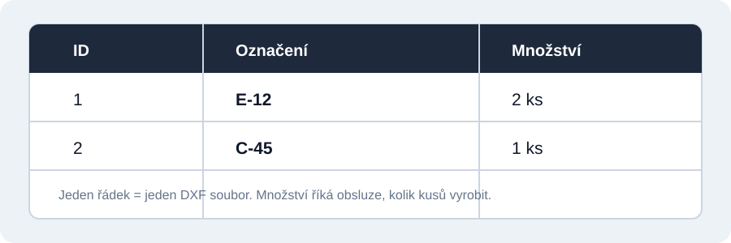
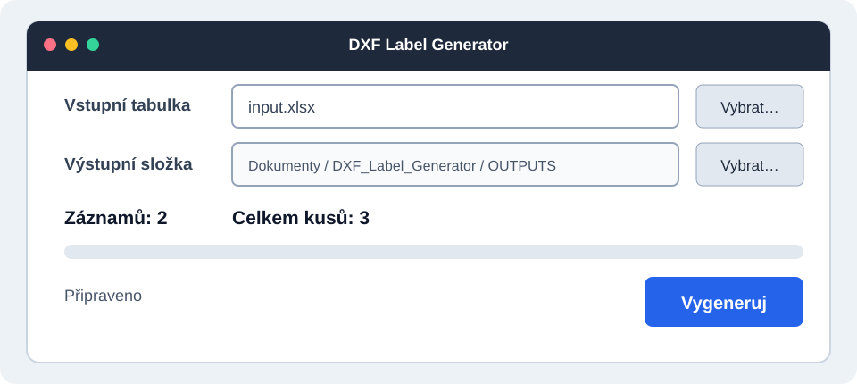
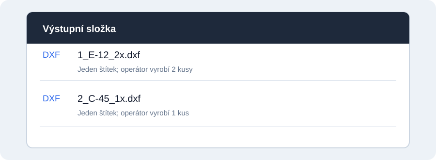

# Uživatelská příručka

## DXF Label Generator

Příručka pro obsluhu generátoru potrubních štítků. Aplikace vytvoří jeden DXF soubor pro každý řádek tabulky. Počet kusů v řádku je určen obsluze stroje; další kopie DXF se podle něj nevytvářejí.

## 1. Připravte vstupní tabulku

Tabulka musí mít první tři sloupce v tomto pořadí: **ID**, **Označení**, **Množství**. Hlavička je doporučená, ale není povinná.



Podporované vstupy:

- CSV oddělené středníkem (`;`), uložené jako UTF-8 nebo Windows-1250.
- Excelový soubor `.xlsx`; použije se aktivní list sešitu.

Označení může obsahovat písmena, číslice, mezery a spojovník, například `E-12`, `C-45` nebo `Uzel 1`. Množství zadejte jako číslo nebo text, například `2` či `2 ks`.

## 2. Spusťte aplikaci

Po zveřejnění vydání otevřete stránku [Releases projektu](https://github.com/PetrOdst/DXF_lable_generator/releases) a stáhněte balíček pro svůj systém:

- **Windows 11:** stáhněte `DXF_Label_Generator.exe` a spusťte jej.
- **Linux x86-64:** stáhněte `DXF_Label_Generator-linux-x86_64.tar.gz`, rozbalte archiv a spusťte `DXF_Label_Generator`.

V Linuxu můžete aplikaci spustit z Terminálu ve složce po rozbalení:

```bash
./DXF_Label_Generator
```

Pokud systém oznámí, že soubor nemá oprávnění ke spuštění, nastavte je a spusťte aplikaci znovu:

```bash
chmod +x DXF_Label_Generator
./DXF_Label_Generator
```

## 3. Vyberte tabulku a cílovou složku



1. U **Vstupní tabulka** klikněte na **Vybrat…** a zvolte CSV nebo `.xlsx`.
2. Aplikace zobrazí počet záznamů a součet kusů. Zkontrolujte, že čísla odpovídají tabulce.
3. U **Výstupní složka** můžete vybrat, kam se mají DXF soubory uložit. Výchozí složka hotové aplikace je `Dokumenty/DXF_Label_Generator/OUTPUTS`.

## 4. Vygenerujte soubory

Klikněte na **Vygeneruj**. Během práce se zobrazí stav **Pracuje** a ukazatel průběhu. Po dokončení aplikace oznámí **Hotovo** a počet vytvořených DXF souborů.

Před začátkem aplikace kontroluje, zda se text při nastavené velikosti vejde mezi otvory. Pokud ne, zobrazí chybovou zprávu s označením a rozměry. Opravte tabulku nebo požádejte správce aplikace o úpravu pevné konfigurace.

## 5. Najděte výsledek

Ve vybrané složce bude jeden DXF na každý záznam. Název obsahuje ID, označení a počet kusů:



Například `1_E-12_2x.dxf` znamená jeden DXF štítek, který má obsluha vyrobit dvakrát. Pokud by stejnojmenný soubor už existoval, aplikace přidá k názvu pořadové číslo a původní soubor nepřepíše.

## Nastavení štítku

Rozměry štítku, otvory a velikost písma jsou pevně nastavené v `config.csv` dodaném s aplikací. V běžném provozu tento soubor neměňte; změnu nastavení řešte se správcem generátoru.
